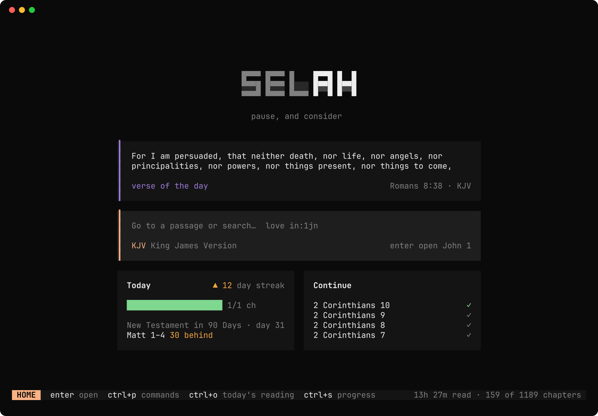
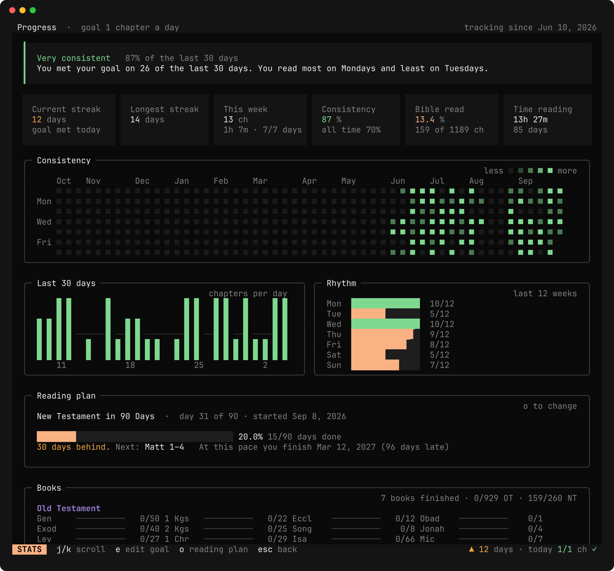
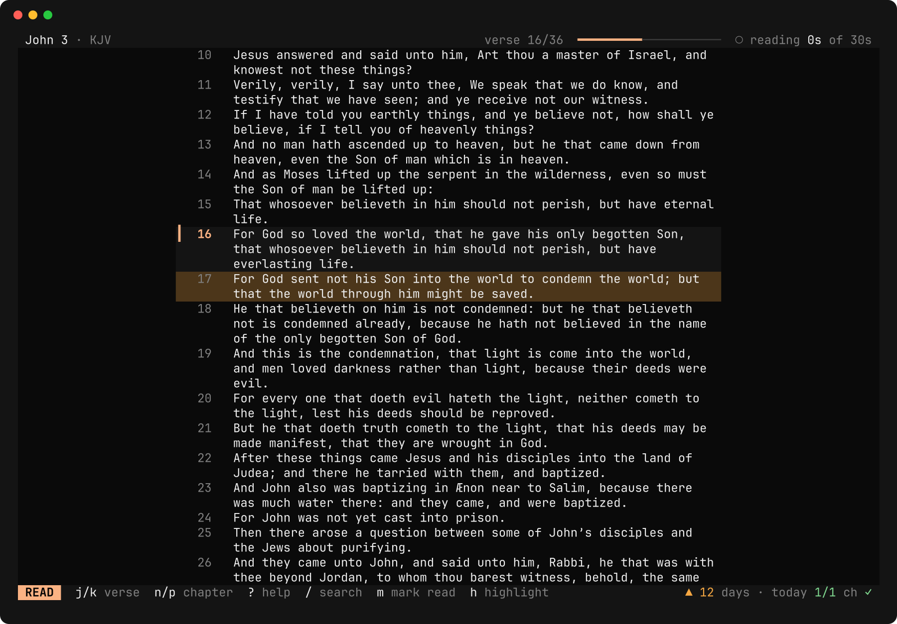
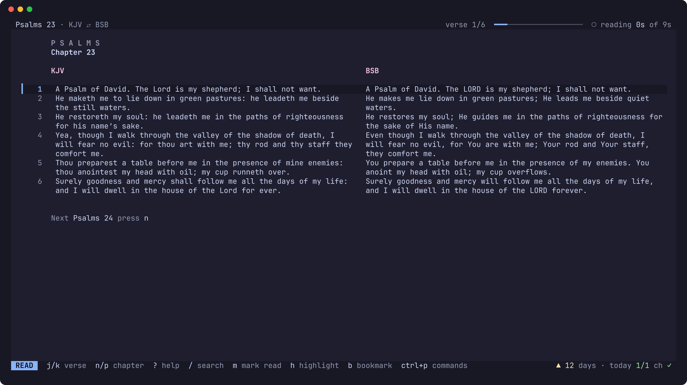

# Selah

A Bible for the terminal, built on the same TUI stack as [opencode](https://github.com/anomalyco/opencode)
(OpenTUI and Solid on Bun), with a reading tracker that tells you honestly whether you are consistent.



## What it does

- **Reads well.** A centred reading column, a verse cursor, KJV's supplied words in italics, four
  highlight colours, bookmarks, notes, and parallel translations side by side.
- **Finds anything.** `ctrl+p` opens a command palette that also understands references
  (`jn 3:16`, `1 cor 13:4-7`, `song of songs 2`). `/` searches every verse with ranked,
  highlighted results, phrases in quotes, and filters such as `in:psalms`, `in:ot` and `in:nt`.
- **Tracks reading you actually did.** A chapter counts once you reach its end *and* have spent
  real time on it (30% of the time it takes to read at 250 words a minute, capped at 30 seconds),
  or when you press `m`. Time away from the keyboard for more than three minutes is not counted.
- **Shows whether you are consistent.** Current and longest streak, a daily goal in chapters or
  minutes, consistency over 7, 30 and 365 days, a 53-week heatmap, a 30-day chart, which weekdays
  you read on, and progress through every book.
- **Keeps you on a plan.** Bible in a Year, in Two Years, New Testament in 90 Days, the Gospels in
  30 Days, Psalms and Proverbs in a Month. Portions are balanced by word count, and Selah tells you
  how far ahead or behind you are and when you will finish at your current pace.
- **Matches your rice.** opencode's 33 themes with live preview, plus `system`, which uses your
  terminal's own palette.
- **Works offline.** Translations download once into a local SQLite database with full-text search.







## Install

Requires [Bun](https://bun.sh) 1.4 or later to build.

```sh
git clone <this repo> selah && cd selah
bun install
bun run build                       # dist/selah, one self-contained executable
install -Dm755 dist/selah ~/.local/bin/selah
```

Or run from source with `bun src/index.tsx`.

The first launch downloads the King James Version and the Berean Standard Bible (about 8 MB each).
After that, Selah needs no network.

## Use

```sh
selah                         # open the app
selah john 3:16               # open at a passage
selah ps 23 -p                # print a passage and exit
selah search "living water"   # print search results
selah stats                   # streak, today, consistency
selah install ASV YLT NHEB    # more translations
```

### Keys

| Reading | | Study | | Tracking | |
|---|---|---|---|---|---|
| `j` `k` | next / previous verse | `h` | highlight | `m` | mark chapter read |
| `n` `p` | next / previous chapter | `b` `B` | bookmark / list | `s` | progress |
| `space` | page down | `a` | note on verse | `ctrl+o` | today's reading |
| `16 enter` | jump to verse 16 | `v` `y` | select / copy | `ctrl+p` | commands |
| `o` | go to book | `t` `T` | translation / parallel | `?` | all keys |
| `/` | search | `ctrl+b` | sidebar | `q` | quit |

### Your streak in waybar

`selah stats --json` prints waybar's custom-module format (`text`, `tooltip`, `class`), where
`class` is `met`, `pending` or `none`:

```jsonc
"custom/selah": {
  "exec": "selah stats --json",
  "return-type": "json",
  "interval": 300,
  "on-click": "foot -e selah"
}
```

## Translations

All are public domain, taken from [scrollmapper/bible_databases](https://github.com/scrollmapper/bible_databases)
(MIT) at a pinned commit.

| ID | Translation | Year |
|---|---|---|
| KJV | King James Version | 1769 |
| BSB | Berean Standard Bible | 2022 |
| ASV | American Standard Version | 1901 |
| YLT | Young's Literal Translation | 1898 |
| NHEB | New Heart English Bible | 2010 |

## Files

- `$XDG_DATA_HOME/selah/bible.db`: the texts and their search index.
- `$XDG_DATA_HOME/selah/user.db`: your reading sessions, reads, highlights, bookmarks and notes.
  It is separate from the texts, so adding or removing a translation never touches it.
- `$XDG_CONFIG_HOME/selah/config.json`: theme, mode, translation, daily goal. Safe to edit by hand.

`SELAH_HOME` puts all three under one directory. `SELAH_NO_PALETTE=1` skips the terminal palette
query for terminals that mishandle it. `SELAH_DEBUG_LOG=<file>` writes errors to a file.

## Development

```sh
bun test               # data, tracker, stats, plans, themes and rendered UI frames
bun run typecheck
bun scripts/screenshots.tsx   # regenerate docs/screenshots from real frames
```

The design rules every screen follows are in [docs/DESIGN.md](docs/DESIGN.md). Themes in
`src/theme/assets` are opencode's, used under its MIT license.
